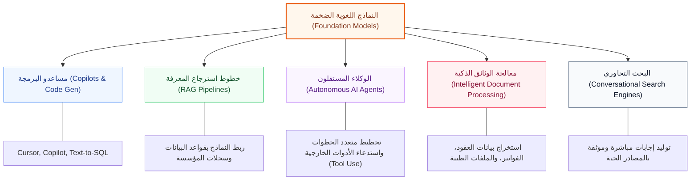

# Chapitre 1 — مدخل شامل إلى النماذج اللغوية الضخمة (Introduction aux LLM)
## ماجستير علوم البيانات (2MDS) & إنترنت الأشياء (2MIoT) — المعهد العالي للغات المطبقة والإعلامية بباجة (ISLAIB)

> [!abstract] بطاقة تعريفية بالمحاضرة (Course Metadata)
> * **المادة**: النماذج اللغوية الضخمة (*Large Language Models - LLM*).
> * **الأستاذة المحاضرة**: د. كوثر الزمّالي (*Dr. Kaouther Ezzameli*).
> * **السنة الجامعية**: 2026 - 2027.
> * **المحور الأساسي**: التموضع المفاهيمي للنماذج اللغوية، التطور التاريخي من نماذج الـ N-Grams إلى المحولات (*Transformers*)، الميكانيزمات الجوهرية، اقتصاديات التدريب والبارامترات، وأبرز مجالات التطبيق المعاصرة.
> * **الملف المصدري**: `LLM CH1.pdf`.
> * **الارتباطات المنهجية**: يتكامل هذا الدرس مع الورشة التطبيقية [[01_Atelier_Evolution_Architectures_RNN_au_Transformer]] ومشروع المادة [[01_Cahier_Des_Charges_Mini_Projets_LLM]].

---

## 1. التموضع المفاهيمي والهرمية البنيوية (Landscape & Conceptual Hierarchy)

لفهم ماهية النماذج اللغوية الضخمة (*Large Language Models - LLMs*) بدقة أكاديمية، يجب أولاً تحديد موقعها داخل منظومة علوم الحاسوب والذكاء الاصطناعي عبر التسلسل الهرمي التالي:

1. **الذكاء الاصطناعي (Artificial Intelligence - AI)**: المظلة الكبرى الشاملة لكافة النظم والبرمجيات القادرة على محاكاة الوظائف المعرفية البشرية (*Cognitive Functions*)؛ مثل التفكير المنطقي، الإدراك البصري، فهم الكلام، اتخاذ القرارات، وتحليل البيانات المعقدة.
2. **تعلّم الآلة (Machine Learning - ML)**: فرع جوهري من الذكاء الاصطناعي يرتكز على تمكين الأنظمة الحاسوبية من استنباط الأنماط والتعلم التلقائي من التجارب والبيانات التجريبية (*Empirical Data*) دون الحاجة إلى برمجتها مسبقاً بقواعد صلبة مقيدة (*Hard-coded rules*).
3. **التعلم العميق (Deep Learning - DL)**: فئة متقدمة متفرعة من تعلم الآلة تعتمد على **الشبكات العصبية الاصطناعية متعددة الطبقات (*Multilayer Artificial Neural Networks*)** لمحاكاة المعالجة المتوازية للدماغ البشري، واستخراج تمثيلات هرمية تجريدية للميزات (*Hierarchical Feature Representation*).
4. **معالجة اللغات الطبيعية (Natural Language Processing - NLP)**: حقل تقاطع حيوي بين الذكاء الاصطناعي واللسانيات الحاسوبية، يهدف إلى منح الحواسيب القدرة على قراءة، فهم، تأويل، وتوليد اللغة البشرية الطبيعية بشتى صورها المنطوقة والمكتوبة.
5. **النماذج اللغوية الضخمة (Large Language Models - LLMs)**: ذروة التطور المعاصر في معالجة اللغات الطبيعية؛ وهي نماذج عصبية عميقة قائمة على معمارية المحوّلات (*Transformer Architecture*)، دُرّبت على مليارات الكلمات والنصوص لإنجاز طيف واسع جداً من المهام التوليدية والتحليلية.

### المخطط الهرمي للعلاقة التضمينية

![[assets/llm_landscape_hierarchy.svg]]

> [!info] الشرح المفاهيمي للمخطط أعلاه
> يجسد المخطط التضميني السابق موقع الـ **LLMs** كنواة متقدمة تقع في قلب تقاطع **التعلم العميق (Deep Learning)** و**معالجة اللغات الطبيعية (NLP)** تحت مظلة **تعلّم الآلة (Machine Learning)** و**الذكاء الاصطناعي (AI)**. تتفرد النماذج الضخمة بثلاث ركائز استثنائية:
> 1. **الحجم الهائل (Massive Scale)**: مليارات البارامترات وترليونات الرموز اللغوية (*Tokens*).
> 2. **المحرك التنبؤي الذاتي (Autoregressive Engine)**: التنبؤ بالرمز اللغوي التالي كقاعدة تدريب غير مراقبة (*Self-Supervised Learning*).
> 3. **القدرات المنبثقة (Emergent Abilities)**: بروز مهارات معقدة غير متوقعة (مثل حل المسائل الرياضية، الاستنتاج المنطقي خطوة بخطوة، والبرمجة) نتيجة التوسع في مقياس التدريب (*Scaling Laws*).

---

## 2. ما هو النموذج اللغوي الضخم؟ (Qu'est-ce qu'un LLM ?)

النموذج اللغوي الضخم (*LLM*) في جوهره الرياضي والبرمجي هو **برنامج احتمالي يقوم بالتنبؤ بالرمز اللغوي التالي (*Next Token Prediction*)** داخل سياق نصي معين، دُرّب على مجموعات بيانات نصية ضخمة تغطي مليارات إلى ترليونات الرموز من الإنترنت، الكتب، والأكواد المصدرية.

> [!tip] سر القوة الكامنة في المهمة التنبؤية البسيطة
> على الرغم من أن مهمة النموذج أثناء التدريب تبدو ميكانيكية بحتة (تخمين الكلمة التالية)، إلا أن النجاح في التنبؤ الدقيق عبر سياقات متنوعة يُلزم النموذج بالاستيعاب الضمني لقواعد النحو، دلالات الألفاظ (*Semantics*)، المنطق، المعارف العامة عن العالم، وحتى أسلوب ونبرة المتحدث!

### لماذا تسمى بـ "الضخمة" (Large) ؟
يرجع وصف هذه النماذج بالضخمة أو العملاقة إلى عاملين رئيسيين:
1. **عدد البارامترات الهائل (Parameter Count)**: تمتلك النماذج أوزاناً مشبكية (*Weights & Biases*) تتراوح بين مليارات ومئات المليارات أو الترليونات (مثل GPT-3 ذي 175 مليار بارامتر، وGPT-4 و Gemini).
2. **الموارد الحاسوبية والبيانات المستهلكة**: تتطلب مزارع ضخمة من معالجات الرسوميات المتقدمة (*GPUs/TPUs*)، ومساحات تخزين فائقة السرعة، وأسابيع إلى أشهر من المعالجة المكثفة المستمرة.

### المهام الأساسية السبع للنماذج اللغوية (The 7 Core LLM Tasks)
تستطيع النماذج اللغوية إنجاز طيف متكامل من الوظائف:
1. **توليد النصوص (Text Generation)**: كتابة مقالات، بريد إلكتروني، تقارير منظمة، ورسائل موجهة.
2. **الترجمة الآلية (Machine Translation)**: ترجمة فورية تراعي السياق اللغوي والمصطلحات التخصصية.
3. **التلخيص الآلي (Text Summarization)**: استخلاص الأفكار الجوهرية من وثائق مطولة ومتعددة.
4. **الإجابة عن الأسئلة وروبوتات المحادثة (Q&A & Chatbots)**: حوارات تفاعلية ذكية مدعومة بتقنيات استرجاع المعلومات (*RAG*).
5. **تصنيف النصوص (Text Classification)**: تصنيف التذاكر، فرز المقالات العلمية، والفرز الآلي للسير الذاتية.
6. **تحليل الآراء والمشاعر (Sentiment Analysis)**: تحديد نبرة العميل (إيجابي، سلبي، محايد) ومستوى الإلحاح.
7. **المساعدة البرمجية وتوليد الأكواد (Code Generation & Copilots)**: كتابة الدوال، تحويل الاستعلامات النصية إلى SQL، تصحيح الأخطاء البرمجية (*Debugging*)، وكتابة الاختبارات الأحادية.

---

## 3. الصياغة الرياضية لنمذجة اللغة (Mathematical Formulation of Language Modeling)

رياضياً، تتعامل نماذج اللغة مع النص كسلسلة زمنية متتابعة من الرموز اللغوية $W = (w_1, w_2, \dots, w_T)$.

### الاحتمال المشترك للسلسلة النصية (Joint Probability)
يُحسب احتمال ظهور جملة كاملة عبر تطبيق **قاعدة السلسلة للاحتمالات (*Chain Rule of Probability*)**:

$$P(W) = P(w_1, w_2, \dots, w_T) = \prod_{t=1}^{T} P(w_t \mid w_1, w_2, \dots, w_{t-1})$$

حيث:
* $w_t$: الرمز اللغوي عند الخطوة الزمنية $t$.
* $w_{<t} = (w_1, \dots, w_{t-1})$: السياق السابق (*Prefix / Prompt*).
* $P(w_t \mid w_{<t})$: دالة التوزيع الاحتمالي للكلمة القادمة المشروطة بالسياق التاريخي السابق.

يقوم النموذج اللغوي العصبي بتوليد متجه من القيم الرقمية الخام (*Logits*) بطول حجم المعجم اللغوي $|V|$، ثم يُحولها إلى توزيع احتمالي صريح باستخدام دالة **سوفت ماكس (*Softmax*)**:

$$P(w_t = v_k \mid w_{<t}) = \frac{\exp(z_k)}{\sum_{j=1}^{|V|} \exp(z_j)}, \quad \forall v_k \in V$$

---

## 4. المسار التاريخي وتطور معماريات معالجة اللغة (From N-Grams to Transformers)

شهد ميدان معالجة اللغات الطبيعية عبر العقود السبعة الماضية تحولات جذرية في كيفية تمثيل اللغة وحساب الاحتمالات:

![[assets/evolution_ngrams_to_transformers.svg]]

> [!info] الشرح المفاهيمي لمخطط التطور التاريخي
> يستعرض المخطط المحطات الخمس الكبرى التي قادت إلى الثورة الراهنة للنماذج اللغوية:
> 1. **نماذج الـ N-Gram (1948 - التسعينيات)**: احتمالات إحصائية تعتمد على تكرارات الكلمات مع افتراض ماركوف المحدود.
> 2. **التضمينات اللغوية العصبية (2013 - 2015)**: تمثيل الكلمات كمتجهات متراصة في فضاء رياضي مستمر يحافظ على العلاقات الدلالية (مثل Word2Vec و GloVe).
> 3. **الشبكات العصبية المتكررة وLSTM (2014 - 2016)**: معالجة السلاسل النصية خطوة بخطوة مع المحافظة على حالة الذاكرة الخفية، لكنها عانت من التلاشي التدريجي للمعلومات واستحالة المعالجة المتوازية.
> 4. **ثورة المحولات (2017)**: إقصاء التكرار الزمني بالكامل والاعتماد الحصري على **الانتباه الذاتي المتعدد (Multi-Head Self-Attention)** الذي يسمح بمعالجة النص كاملاً دفعة واحدة بالتوازي.
> 5. **عصر النماذج العملاقة والمتعددة الوسائط (2018 - الآن)**: التوسع غير المسبوق في حجم النماذج والبيانات وظهور القدرات المنبثقة ومعالجة النصوص والصور والأصوات والأكواد معاً.

---

### 4.1 نماذج الـ N-Grams (الحقبة الإحصائية 1948 - التسعينيات)
يعتمد نموذج الـ $n$-gram على **فرضية ماركوف من الدرجة $(n-1)$ (*Markov Assumption*)**، مفترضاً أن احتمال ظهور الكلمة الحالية يعتمد فقط على عدد محدود من الكلمات السابقة وليس كامل تاريخ الجملة:

$$P(w_t \mid w_1, \dots, w_{t-1}) \approx P(w_t \mid w_{t-n+1}, \dots, w_{t-1})$$

* **Unigram ($n=1$)**: يفترض استقلالية الكلمات تماماً: $P(w_t)$.
* **Bigram ($n=2$)**: ينظر إلى الكلمة السابقة فقط: $P(w_t \mid w_{t-1}) = \frac{\text{Count}(w_{t-1}, w_t)}{\text{Count}(w_{t-1})}$.
* **Trigram ($n=3$)**: ينظر إلى الكلمتين السابقتين: $P(w_t \mid w_{t-2}, w_{t-1})$.

> [!example] مثال توضيحي
> في العبارة: `"I want to eat a slice of ..."`
> نموذج الـ Trigram سيعتمد فقط على `("slice", "of")` لتوقع الكلمة التالية، مما يجعله عاجزاً عن ربط الكلمة بالدافع الأصلي `"eat"` الموجود في بداية الجملة، وسيفشل في ترجيح كلمة مثل `"cake"` ما لم تكن العبارة الحرفية مسجلة بتكرار كافٍ في بيانات التدريب.

* **المزايا**: بساطة الحساب، سرعة فائقة، ولا تتطلب قدرات حاسوبية عصبية أو بطاقات رسومية.
* **العيوب القاتلة**:
  - **انعدام الفهم الدلالي**: الكلمات تُعامل كمعرفات رقمية مستقلة (*Discrete Tokens*)؛ لا توجد أي صلة رياضية بين كلمة "كلب" و"جرو".
  - **شح البيانات والندرة (*Data Sparsity*)**: أي تركيب جديد لم يسبق وروده يأخذ احتمالاً صفرياً ما لم تُطبق تقنيات التنعيم (*Smoothing*).
  - **جمود نافذة السياق**: العجز البنيوي عن التقاط العلاقات بعيدة المدى.

---

### 4.2 التضمين اللغوي العصبي وفضاء المتجهات (Word Embeddings: 2013 - 2015)
أحدثت نماذج التضمين العصبي مثل **Word2Vec (CBOW & Skip-Gram)** للمطور ميكولوف (*Mikolov et al.*) و**GloVe** من ستانفورد نقلة ثورية عبر تحويل الكلمات المنفصلة إلى متجهات كثيفة مستمرة $\mathbb{R}^d$ (عادةً بأبعاد 100 إلى 300 بُعد).

تتميز هذه الفضاءات بقدرتها المذهلة على التقاط **التشابه الدلالي والعمليات الجبرية التناظرية (*Vector Analogies*)**:

$$\vec{v}_{\text{Roi}} - \vec{v}_{\text{Homme}} + \vec{v}_{\text{Femme}} \approx \vec{v}_{\text{Reine}}$$
$$\vec{v}_{\text{Paris}} - \vec{v}_{\text{France}} + \vec{v}_{\text{Italie}} \approx \vec{v}_{\text{Rome}}$$

> [!warning] القيد الجوهري للـ Word Embeddings التقليدية
> تُعد متجهات Word2Vec و GloVe **مستقلة عن السياق (*Context-Independent*)**؛ فالكلمة الواحدة تمتلك متجهاً ثابتاً واحداً بصرف النظر عن معناها في الجملة. فمثلاً كلمة **"Apple"** ستحصل على نفس المتجه سواء قصدت شركة التكنولوجيا أم ثمرة التفاح! كما أنها لا تملك آلية لتتبع الترتيب النحوي للجمل الطويلة.

---

### 4.3 الشبكات العصبية المتكررة وذاكرة المدى الطويل القصير (RNNs & LSTMs: 2014 - 2016)
للتغلب على عيب فقدان الترتيب والذاكرة، ظهرت **الشبكات العصبية المتكررة (*Recurrent Neural Networks - RNN*)**. تقوم الفكرة على معالجة النص رمزاً تلو الآخر بالتتابع الزمني، مع تمرير متغيّر داخلي يُدعى **الحالة الخفية (*Hidden State $h_t$*)** كذاكرة للمعلومات التراكمية:

$$h_t = \tanh(W_{hh} h_{t-1} + W_{xh} x_t + b_h)$$

$$y_t = \text{Softmax}(W_{hy} h_t + b_y)$$

#### مشكلة تلاشي وانفجار التدرج (Vanishing & Exploding Gradients)
عند تدريب الـ RNN عبر الزمن (*Backpropagation Through Time - BPTT*) على سلاسل نصية طويلة (أكثر من 20 إلى 50 كلمة)، يتلاشى التدرج الرياضي $\frac{\partial \mathcal{L}}{\partial h_1}$ أُسّياً أثناء الرجوع إلى الوراء بسبب الضرب المتكرر في مصفوفة الأوزان المشبكية، مما يحرم النموذج من تعلم الارتباطات النصية البعيدة.

#### حل الـ LSTM (Long Short-Term Memory)
ابتكر الباحثان هوخرايتر وشميدهوبر (*Hochreiter & Schmidhuber*) معمارية **LSTM** التي أدخلت **حالة الخلية (*Cell State $C_t$*)** كشريط نقل سريع للمعلومات، تحكمه ثلاث بوابات منطقية عصبية:
1. **بوابة النسيان ($f_t$ - Forget Gate)**: تحدد المقدار الواجب حذفه من الذاكرة القديمة:
   $$f_t = \sigma(W_f \cdot [h_{t-1}, x_t] + b_f)$$
2. **بوابة الإدخال ($i_t$ - Input Gate)**: تحدد المعلومات الجديدة المؤهلة للتخزين:
   $$i_t = \sigma(W_i \cdot [h_{t-1}, x_t] + b_i), \quad \tilde{C}_t = \tanh(W_c \cdot [h_{t-1}, x_t] + b_c)$$
   $$C_t = f_t * C_{t-1} + i_t * \tilde{C}_t$$
3. **بوابة الإخراج ($o_t$ - Output Gate)**: تحسب المخرج والحالة الخفية الجديدة:
   $$o_t = \sigma(W_o \cdot [h_{t-1}, x_t] + b_o), \quad h_t = o_t * \tanh(C_t)$$

---

### 4.4 ثورة المحولات (The Transformer Revolution: 2017)

رغم القوة التي قدمتها شبكات الـ LSTM، إلا أنها واجهت عقبتين بنيويتين لا يمكن تجاوزهما:
1. **الطبيعة المتسلسلة القسرية (*Sequential Bottleneck*)**: لا يمكن حساب الكلمة $t$ إلا بعد الانتهاء من حساب الخطوات $t-1, \dots, 1$ السابقة، مما يعطل استغلال المعالجة المتوازية الضخمة التي تتيحها معالجات الرسوميات الحديثة (*GPUs*).
2. **عنق زجاجة المتجه الثابت (*Fixed Vector Bottleneck*)**: تلخيص جملة كاملة من 100 كلمة في متجه ثابت الحجم يؤدي حتماً إلى فقدان التفاصيل الدقيقة للمعلومات المبكرة.

![[assets/transformer_attention_vs_rnn_bottleneck.svg]]

> [!info] الشرح المفاهيمي للمقارنة المعمارية
> يبرز المخطط أعلاه الفارق الهيكلي الجذري بين النمطين:
> * **في اليسار (RNN)**: تنتقل المعلومة في سلسلة خطية بطيئة؛ تتناقص قوة الإشارة تدريجياً (*Vanishing Signal*)، وتُضغط في حالة خفية وحيدة.
> * **في اليمين (Transformer)**: تلغى التبعية الزمنية، وتُعالج جميع الرموز في آن واحد. عبر **مصفوفة الانتباه الذاتي (*Self-Attention Matrix*)**، يمتلك كل رمز طريقاً مباشراً بطول $\mathcal{O}(1)$ للتواصل مع أي رمز آخر في النص بغض النظر عن المسافة الفاصلة بينهما!

#### معادلة الانتباه القياسي للجداء النقطي (Scaled Dot-Product Attention)
ينشئ النموذج لكل رمز لغوي ثلاثة متجهات عبر إسقاطات خطية قابلة للتعلّم:
* **الاستعلام ($Q$ - Query)**: ما الذي يبحث عنه الرمز الحالي؟
* **المفتاح ($K$ - Key)**: ما هي الهوية والمعلومات التي يقدمها الرمز للمطابقة؟
* **القيمة ($V$ - Value)**: المحتوى الدلالي الحقيقي الذي سيتم دمجه.

$$\text{Attention}(Q, K, V) = \text{Softmax}\left(\frac{Q K^T}{\sqrt{d_k}} + M\right) V$$

حيث:
* $\frac{1}{\sqrt{d_k}}$: عامل التقييس لمنع تضخم قيم الجداء النقطي عند الأبعاد الكبيرة، مما يحمي دالة الـ Softmax من الدخول في مناطق الإشباع وانعدام التدرج.
* $M$: قناع اختياري (*Attention Mask*) لحجب الرموز المحشوة (*Padding*) أو حجب الكلمات المستقبلية في النماذج التوليدية السببية (*Causal Masking*).

![[assets/self_attention_mechanism.svg]]

> [!info] الشرح التطبيقي لآلية الانتباه الذاتي وفك اللبس المرجعي (Coreference Resolution)
> يجسد المخطط أعلاه المثال الكلاسيكي الوارد في شريحة الدرس (Slide 20): *"She dropped the glass because it was fragile."*:
> 1. **الرمز المستهدف بالاستعلام (Query Focus)**: عند معالجة الضمير **"it"**، يُنشئ النموذج متّجه استعلام $q_{\text{it}}$ يسأل دلالياً: *"ما هو الشيء المعني هنا؟"*.
> 2. **حساب التوافق مع المفاتيح (Matching Keys)**: يُضرب متّجه الاستعلام نقطياً في متجهات المفاتيح لكافة كلمات الجملة. نلاحظ أن الجداء النقطي بين *"it"* والاسم *"glass"* يُعطي أعلى قيمة عددية لأن الصفة *"fragile"* في سياق الجملة ترتبط بالزجاج لا بالمرأة (*She*).
> 3. **توزيع أوزان الانتباه عبر Softmax**: تُحوّل الدرجات إلى احتمالات مجموعها $1.0$. ينال الرمز *"glass"* حصة الأسد بوزن انتباه ساحق ($\alpha = 0.82$)، ويليه التعليل الدلالي *"fragile"* بنسبة ($\alpha = 0.11$)، بينما يُهمش الضمير *"She"* بنسبة ضئيلة جداً ($\alpha = 0.03$).
> 4. **تركيب المتجه السياقي النهائي (Contextualized Vector)**: يتم جمع متجهات القيمة (*Values $V$*) مرجحة بهذه الأوزان. والنتيجة أن التمثيل الرياضي الجديد للضمير *"it"* لم يعد متجهاً معزولاً، بل أصبح مشبعاً بالكامل بهوية الزجاج وسبب سقوطه!

---

### 4.5 عصر التوسع والنماذج التأسيسية متعددة الوسائط (2018 - الآن)
أتاحت القابلية الهائلة للمحولات للموازاة إطلاق سباق محموم لتكبير النماذج وتوسيع نوافذ السياق:
* **توسع نوافذ السياق (*Context Windows*)**: قفزت النوافذ من 512 رمزاً في أول نماذج BERT و GPT-1 إلى 8,000 ثم 32,000، لتصل في النماذج الحديثة إلى **مليون رمز وأكثر** (مثل Gemini 1.5 Pro).
* **الانفجار في عدد البارامترات**: الانتقال من ملايين البارامترات إلى مئات المليارات والترليونات.
* **الوسائط المتعددة الأصلية (*Native Multimodality*)**: لم تعد النماذج محصورة بالنصوص، بل دُرّبت بشكل موحد على نصوص، صور، فيديو، مقاطع صوتية، وأكواد برمجية.

---

## 5. بارامترات النماذج واقتصاديات التدريب (Model Parameters & Training Economics)

### 5.1 مقارنة أحجام البارامترات بين أجيال النماذج

| النموذج (*Model*) | الجهة المطوّرة (*Organization*) | سنة الإصدار | عدد البارامترات (*Parameters*) | نافذة السياق (*Context*) |
| :--- | :--- | :---: | :---: | :---: |
| **GPT-1** | OpenAI | 2018 | 117 مليون (117M) | 512 رمز |
| **BERT-Large** | Google | 2018 | 340 مليون (340M) | 512 رمز |
| **GPT-2** | OpenAI | 2019 | 1.5 مليار (1.5B) | 1,024 رمز |
| **GPT-3** | OpenAI | 2020 | 175 مليار (175B) | 2,048 رمز |
| **LLaMA-2-7B** | Meta AI | 2023 | 7 مليارات (7B) | 4,096 رمز |
| **Mistral-7B** | Mistral AI | 2023 | 7.3 مليارات (7.3B) | 8,192 / 32k رمز |
| **GPT-4** | OpenAI | 2023 | مقدر بنحو 1.8 ترليون (MoE) | 128,000 رمز |
| **DeepSeek-V3** | DeepSeek | 2024 | 671 مليار (37B نشط - MoE) | 128,000 رمز |

---

### 5.2 العوامل المحددة لتكلفة التدريب والحوسبة (Cost Drivers)

تتأثر ميزانية وتكلفة بناء النماذج اللغوية الضخمة بتسعة عوامل تقنية وتنظيمية حاسمة:

1. **حجم النموذج (Model Parameters)**: كلما زاد عدد الأوزان المشبكية، تضاعفت متطلبات ذاكرة الـ VRAM في البطاقات الرسومية وزمن الحوسبة لكل عملية تمرير أمامي وخلفي (*FLOPs*).
2. **بيانات التدريب (Training Data Scale & Quality)**: جمع، تنقية، إزالة التكرار (*Deduplication*)، ومواءمة ترليونات الرموز اللغوية يتطلب خطوط معالجة ضخمة ذات تكلفة باهظة.
3. **البنية التحتية الصلبة (Hardware Infrastructure)**: استخدام عناقيد الحوسبة الفائقة المعتمدة على شرائح متقدمة (مثل NVIDIA H100 / B200 أو Google TPU v5p) مع شبكات ربط بيني فائقة السرعة (*InfiniBand*).
4. **مدة التدريب (Training Duration)**: استمرار مئات أو آلاف البطاقات في الحوسبة المتواصلة لعدة أشهر يرفع التكاليف التشغيلية بشكل هائل.
5. **التحسينات الخوارزمية (Algorithmic Optimizations)**:
   - التدريب بدقة مختلطة (*Mixed Precision FP16 / BF16*) لمضاعفة السرعة وتخفيض استهلاك الذاكرة.
   - موازاة البيانات، خطوط الأنابيب، والتنسورات (*Tensor & Pipeline Parallelism / Megatron-LM*).
   - استخدام معماريات خليط الخبراء (*Mixture of Experts - MoE*) لتفعيل جزء محدد من المعلمات لكل رمز.
6. **الهندسة البرمجية وتصميم الأنظمة**: تجنب الاختناقات في قراءة وكتابة البيانات عبر الذاكرة والتخزين، وإدارة الاتصالات الشبكية بين العقد الحوسبية.
7. **الكوادر البشرية والبحث والتطوير (R&D & Human Capital)**: رواتب فرق الباحثين والمهندسين المشرفين على التدريب وحل معضلات عدم استقرار التدرجات.
8. **استهلاك الطاقة الكهربائية والتبريد (Energy & Electricity)**: تستهلك مراكز البيانات ميغاواتات هائلة من الطاقة، مما يجعل الأثر البيئي والاقتصادي عاملاً حرجاً.
9. **التخزين السريع وإنشاء نقاط التفتيش (Storage & Checkpointing)**: الحفظ الدوري لحالات النموذج لتفادي ضياع أسابيع من التدريب في حال تعطل أحد المعالجات.

---

## 6. مجالات التطبيق المعاصرة (Modern Application Domains)

تجاوزت النماذج اللغوية اليوم مرحلة التجارب الأكاديمية لتصبح الركيزة الأساسية للإنتاجية والبرمجيات الذكية:

### تفصيل التطبيقات الحديثة:
1. **المساعدة البرمجية (AI Copilots)**: أدوات مثل GitHub Copilot و Cursor تندمج مباشرة في بيئات التطوير لكتابة الدوال واقتراح حلول تصحيحية فورية وشرح الأكواد المعقدة.
2. **الجيل المعزز بالاسترجاع (Retrieval-Augmented Generation - RAG)**: التغلب على قيود تاريخ انتهاء تدريب النموذج ومنع الهلوسة عبر ربطه بمستودعات متجهات (*Vector Databases*) تستعلم ملايين الوثائق الخاصة بالشركات لحظياً.
3. **الأنظمة الذاتية ومتعددة الوكلاء (Autonomous Multi-Agent Systems)**: نماذج تتعاون فيما بينها (مثل وكيل مبرمج، وكيل مراجع جودة، ووكيل مدير مشروع) للتخطيط وتنفيذ مهام معقدة واستدعاء واجهات البرمجة (*APIs*).
4. **المعالجة الآلية للوثائق المؤسساتية (Document Processing)**: التدقيق الآلي للعقود القانونية، استخراج البيانات المنظمة من التقارير المالية، ومطابقة الفواتير مع اللوائح التنظيمية.
5. **محركات البحث التحاورية التخليقية**: إعادة صياغة تجربة البحث على الويب لتقديم إجابة فورية جامعة وموثقة بدلاً من مجرد سرد روابط زرقاء تقليدية.

---

## 7. ملخص وأسئلة المراجعة الأكاديمية (Revision & Key Takeaways)

> [!abstract] النقاط الجوهرية الواجب تذكرها
> 1. **النموذج اللغوي** هو آلة احتمالية تتنبأ بالرمز القادم عبر دالة Softmax مطبقة على المعجم اللغوي.
> 2. **نماذج الـ N-Gram** بسيطة وسريعة لكنها تفتقر للفهم الدلالي وتنهار أمام النصوص غير المألوفة.
> 3. **Word Embeddings** نقلت الكلمات إلى فضاء هندسي مترابط، لكنها ظلت أسيرة التمثيلات الساكنة عديمة السياق.
> 4. **الـ RNN و LSTM** وفرت الذاكرة الزمنية، لكن مسارها التتابعي الخطّي منع موازاة التدريب وتسبب في عنق زجاجة للمعلومات.
> 5. **المحوّل (Transformer)** غيّر قواعد اللعبة بفضل **الانتباه الذاتي (Self-Attention)** الذي مكن الحواسيب من استيعاب كافة الكلمات بالتوازي وربط أي كلمتين مباشرة في خطوة واحدة.
> 6. **التوسع (Scaling)** في حجم البارامترات والبيانات هو الوقود الحقيقي لبروز القدرات الذكية المنبثقة للنماذج المعاصرة.

### أسئلة تقييم الفهم:
* **س1**: لماذا يتعذر على شبكات الـ RNN البسيطة التعلم الفعال من الجمل التي تتجاوز 100 كلمة؟ وكيف حاولت بنية LSTM معالجة ذلك؟
* **س2**: ما هو الدور الرياضي لعامل التقييس $\frac{1}{\sqrt{d_k}}$ داخل دالة الانتباه للجداء النقطي؟
* **س3**: اشرح الفارق المفاهيمي بين التضمين اللغوي في Word2Vec والتضمين السياقي الناتج عن طبقات المحوّل (*Transformer*).
* **س4**: ما هي العناصر الأساسية التي تحدد ميزانية تدريب نموذج لغوي مؤسساتي من الصفر؟

---

> [!tip] الخطوة التالية في المنهاج
> للانتقال إلى التطبيق العملي البرمجي لكافة المعماريات التي نوقشت في هذا الفصل، يُرجى فتح كراس العمل التطبيقي:
> * الكراس التفاعلي: [[TP1_Evolution_Architectures_RNN_Transformer.md]]
> * الدليل المنهجي والشرح البرمجي العربي: [[01_Atelier_Evolution_Architectures_RNN_au_Transformer]]
> * دفتر مواصفات المشروع الفصلي: [[01_Cahier_Des_Charges_Mini_Projets_LLM]]
